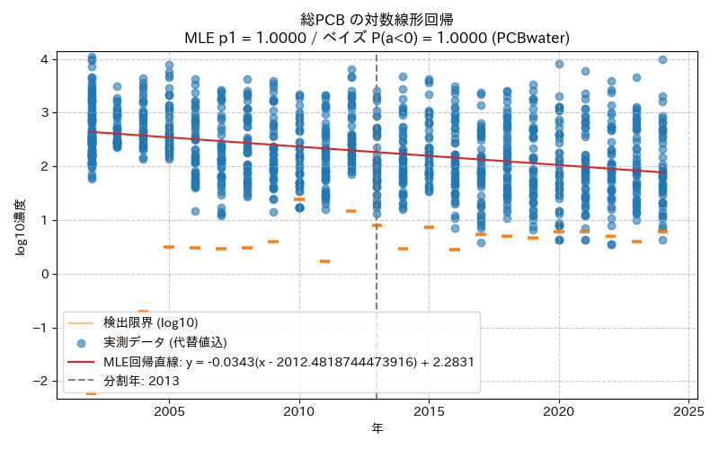

# POPs Trend Analysis (pops_trend_analysis_v1.1a)

**POPs Trend Analysis** は、環境化学物質（POPs: 残留性有機汚染物質など）の経年モニタリングデータを統計的・ベイズ的手法を用いて解析し、トレンド（増加・減少傾向）を評価するための Python パッケージ・スクリプト集です。

対数線形回帰（最尤推定法: MLE）をはじめ、残差KDE（カーネル密度推定）を活用した MCMC ベイズ推論 (`emcee`)、二項回帰モデル（GLM）、ブートストラップ法による多角的な比較分析に対応しています。本スクリプト:pops_trend_analysis_v1.1a.pyは、名称の通り、本サイト集の原型であり、メモリアルの位置づけです。
MCMC（`emcee`）を使用するため計算時間を要します。

---



## 概要・主な機能

- **最尤推定（MLE）による対数線形回帰 & AIC 比較**
  - モデルの適合度を AIC（赤池情報量規準）に基づき評価・比較します。
- **KDE 尤度ベイズ推定 (MCMC / `emcee`)**
  - 残差分布にノンパラメトリックな KDE を適用し、より現実的な分布形状を考慮したベイズ推論を実施します。
  - 収束・信用区間幅に基づく自動早期停止（Auto-Stop）アルゴリズムを標準搭載。快適な実行には性能の高い計算資源を要します。
- **低濃度・不検出データの解析（二項回帰モデル）**
  - 検出限界（DL）以下の比率変化を Binomial GLM でモデル化し、定量値化しにくい低濃度域の評価に対応。
- **期間分割ブートストラップ検定**
  - 前期・後期の平均値差に対する 95% 信頼区間をリサンプリング（Bootstrap）により算出します。
- **自動プロット生成**
  - 実測値、検出限界（DL）、回帰直線、分割年ラインなどを一括可視化し、画像（PNG）として保存します。

---

## MCMC (emcee) 版を採用するメリット・他手法との違い

本リポジトリには FFT 等を用いた高速処理版（`PY_ti_fft_kde_regression`）も含まれていますが、本モジュール（`PY_emcee_kde_regression`）で MCMC サンプリングを行う利点は以下の通りです：

1. **多次元・高機能モデルへの高い拡張性**
   - グリッド近似（FFT等）ではパラメータ数の増加に伴い計算コストが爆発しますが、MCMC（`emcee`）では階層ベイズモデルや複雑な事前分布への拡張が容易です。
2. **パラメータ間の相関および事後分布の精密な可視化**
   - 切片と傾きなどのパラメータ間のトレードオフや歪みを正確に捉え、コーナープロット等での厳密な視覚化・診断が可能です。
3. **正確な信頼区間・予測区間の算出**
   - 正規分布等の近似を置かず、サンプリング結果から直接パーセンタイルを抽出することで、データ数が少ない場合でも現実的で頑健な区間推定が得られます。
4. **サンプラー収束の客観的診断**
   - 自己相関時間（Autocorrelation Time）等を指標として、最適化がローカルミナマに捕まらず確実に収束したかを評価・保証できます。

> **💡 手法の使い分け目安**
> - **大量データの一次スクリーニング・概況確認** $\rightarrow$ **FFT-KDE 版**（計算速度優先）
> - **特定物質の精緻な構造解析・論文提出用データ作成** $\rightarrow$ **`emcee` 版**（表現力・論理的厳密性優先）

---

## ディレクトリ構成

```text
pops_trend_analysis_py/
├── PY_emcee_kde_regression/    # KDEベイズ回帰 (emcee) メイン処理
│   └── pops_trend_analysis_v1.1a.py
├── PY_Hierarchical_emcee/       # 階層ベイズモデル (emcee)
├── PY_Hierarchical_numpyro/     # 階層ベイズモデル (NumPyro)
├── PY_MOE_KDE_AIC/              # MOE / KDE AIC 比較解析
├── PY_pops_moe_analysis_plus/   # 拡張モデル群
├── PY_ti_fft_kde_regression/    # FFTを用いたKDE高速化モデル
├── ST_BREAK_POINTs/             # 変化点分析 (Breakpoint)
├── ST_SARIMA_prediction/        # 時系列予測 (SARIMA)
└── README.md

```

---

## 動作環境・依存ライブラリ

Python 3.8 以上推奨。主な依存ライブラリは以下の通りです：

* `numpy`
* `pandas`
* `matplotlib`
* `scipy`
* `scikit-learn`
* `statsmodels`
* `emcee`
* `japanize-matplotlib` (日本語フォントプロット用)

### インストール例

```bash
pip install numpy pandas matplotlib scipy scikit-learn statsmodels emcee japanize-matplotlib

```

---

## 使い方

### データの準備

`data/` ディレクトリ配下に、以下のカラムを含む CSV ファイルを用意します。

* `substance`: 物質名
* `year`: 観測年
* `site_id`: 調査地点 ID
* `concentration`: 測定濃度値
* `detection_limit`: 検出限界値 (DL)

### 実行方法

`PY_emcee_kde_regression/pops_trend_analysis_v1.1a.py` 内の対象ファイル名 (`filenames`)と必要であれば物質名（`substance`）を設定の上、実行します。通常の上位PCで、数十分単位の計算時間が必要です。

```bash
python PY_emcee_kde_regression/pops_trend_analysis_v1.1a.py

```

### 出力物

1. **変換済みデータ** (`data/<filename>_conv.csv`)
* 欠測値処理や不検出データの代替値処理 ($DL / \sqrt{2}$)、$\log_{10}$ 変換後のデータ。


2. **回帰プロット** (`plots_regression/`)
* 実測データ、検出限界、MLE 回帰直線をプロットした画像ファイル。

3. **HTMLファイル**（`outputs/`,`examples`）

---

## ライセンス

本プロジェクトは MIT ライセンスです。

