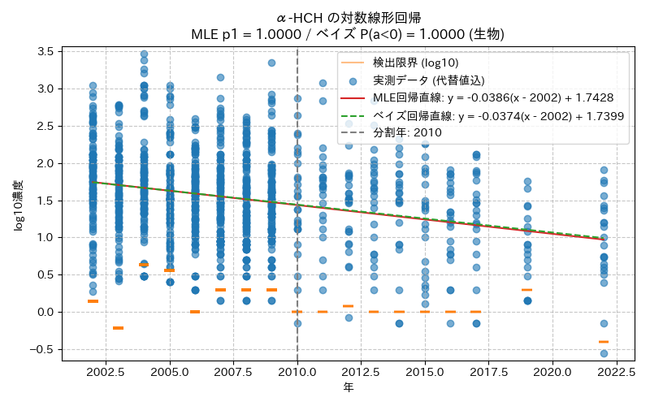

# Environmental Trend Analysis Framework (Water Quality Trend Analyzer)

水質データなどの環境モニタリングデータ（定量下限値・検出限界値 DL が混在・変動する時系列データ）に対して、統計的・ベイズ的アプローチを用いて高い信頼性の傾向分析を行う Python スクリプトです。

頻度主義的な **「GLM（線形・二項ロジスティック回帰）/ AIC」** に加え、高精度なノンパラメトリック手法である **「FFT-KDE によるベイズ推定」** および **「ベイズファクター（Bayes Factor: $BF$）」** を導入し、データ特有の制約（多重検知限界・高頻度不検出・非線形性など）に対しても多角的な検証を可能にしています。

---



## 🌟 主な機能

- **多重検知限界（Multiple DL）への完全対応**
  - 年や測定法によって検出限界が変化する場合でも、データ構造を維持したまま傾向判定が可能。
- **ベイズ推論（FFT-KDE-Bayes & Bayes Factor）**
  - **FFT-KDE（高速フーリエ変換付きカーネル密度推定）** を活用し、パラメータの事前分布・事後分布を高精度の確率密度関数として算出。
  - **ベイズファクター（$BF_{10}$）** を用いて「傾向ありモデル ($H_1$)」と「傾向なしモデル ($H_0$)」の対比を行い、仮説の証拠の強さを定量化。
- **AIC事後確率（$p_1$）による頻度主義的評価**
  - AIC差分から算出される事後確率（$p_1$）とベイズ推定結果を比較検証。
- **多角的な二項ロジスティック回帰**
  - 連続値での解析が困難なデータ（不検出率が高い等）に対し、**DL閾値・25%タイル・75%タイル**等の複数閾値で二項化してトレンドを評価。
- **完全自動化されたレポート出力**
  - 処理結果を Terminal コンソール表示だけでなく、データフレーム（CSV/Excel）、JSON、サマリーHTMLレポートおよび分布プロット画像として自動エクスポート。

---

## 📊 判定ロジックと統計手法

本ツールでは以下のマルチモデル・ロジックに基づき、総合的なトレンド（増加・減少・傾向なし）を自動判定します。


```

[ 入力データ (CSV/Excel) ]
│
├─▶ 1. 連続値トレンド解析 (GLM / OLS)
│     ├─ 通常濃度モデル (Log / Non-log)
│     └─ AIC事後確率 (p1_linear) の算出
│
├─▶ 2. FFT-KDE ベイズ推定 (FFT-KDE-Bayes)
│     ├─ 事前/事後分布のカーネル密度推定 (FFT加速)
│     └─ ベイズファクター (BF10) & 事後分布パラメータの算出
│
├─▶ 3. 二項ロジスティック回帰解析 (GLM Binomial)
│     ├─ DL（検出限界）閾値での二項化
│     ├─ 25%タイル / 75%タイル閾値での二項化
│     └─ それぞれのAIC事後確率 (p1_dl, p1_q25, p1_q75) 算出
│
└─▶ 4. 総合傾向判定 (Trend Decision Engine)

```

### 1. ベイズファクター（$BF_{10}$）の解釈基準

算出されたベイズファクター $BF_{10}$ は、以下の基準（Kass and Raftery, 1995 準拠）に従ってモデルの証拠強度を評価します。

| $BF_{10}$ の値 | 傾向の証拠（$H_1$: 傾向あり） | 判定 |
| :--- | :--- | :--- |
| $> 100$ | **極めて強い証拠 (Decisive)** | 傾向あり（確定） |
| $10 \sim 100$ | **強い証拠 (Strong)** | 傾向あり |
| $3 \sim 10$ | **中程度の証拠 (Substantial)** | 傾向あり（示唆） |
| $1 \sim 3$ | **弱い証拠 (Anecdotal)** | 傾向なし / 不明瞭 |
| $< 1$ | **$H_0$（傾向なし）を支持** | 傾向なし |

---

## 🚀 クイックスタート

### 動作環境・依存ライブラリ

Python 3.8 以上で動作します。FFT-KDE およびベイズ計算に必要なライブラリを含めてインストールしてください。

```bash
pip install numpy pandas scipy statsmodels matplotlib seaborn

```

### 入力データの準備

入力ファイル（CSV または Excel）には、少なくとも以下のカラムが必要です。

| カラム名 | 型 | 説明 |
| --- | --- | --- |
| `year` | int / float | 観測年（例: 2015, 2016...） |
| `concentration` | float | 測定濃度値 |
| `detection_limit` | float (任意) | 検出限界値（DL）。存在する場合、統一下限値の計算やDL二項回帰に使用されます。 |

### 実行方法

```bash
python trend_analysis.py --input data/water_quality.csv

```

---

## 📁 出力ファイル構造

実行が完了すると、`output/` ディレクトリ内に以下の解析結果が生成されます。

```text
output/
├── summary_report.html       # ブラウザで閲覧可能な総合ビジュアルレポート
├── analysis_results.json      # ベイズ推論結果含む完全構造化JSONデータ
├── trend_summary.csv          # 項目ごとの傾向判定一覧 (BF10, p1, 傾き)
└── plots/                     # 回帰直線、KDE事後分布、散布図プロット画像

```

---

## 🛠️ ベイズ計算におけるエラーハンドリング

* **FFT-KDEグリッドの最適化**: データのサンプルサイズが小さい場合やスパイク状の分布が生じる場合、帯域幅（Bandwidth）の自動調整およびグリッド補正が行われます。
* **変数の事前初期化**: データ不備により一部の回帰やベイズ推論が収束しなかった場合でも、システム全体が停止しないよう結果用変数（`a_dl`, `bf10`, `p1_bayes` 等）は事前に `np.nan` で初期化され、安全にレポートが出力されます。

---

## 📜 ライセンス

[MIT License](https://www.google.com/search?q=LICENSE)


