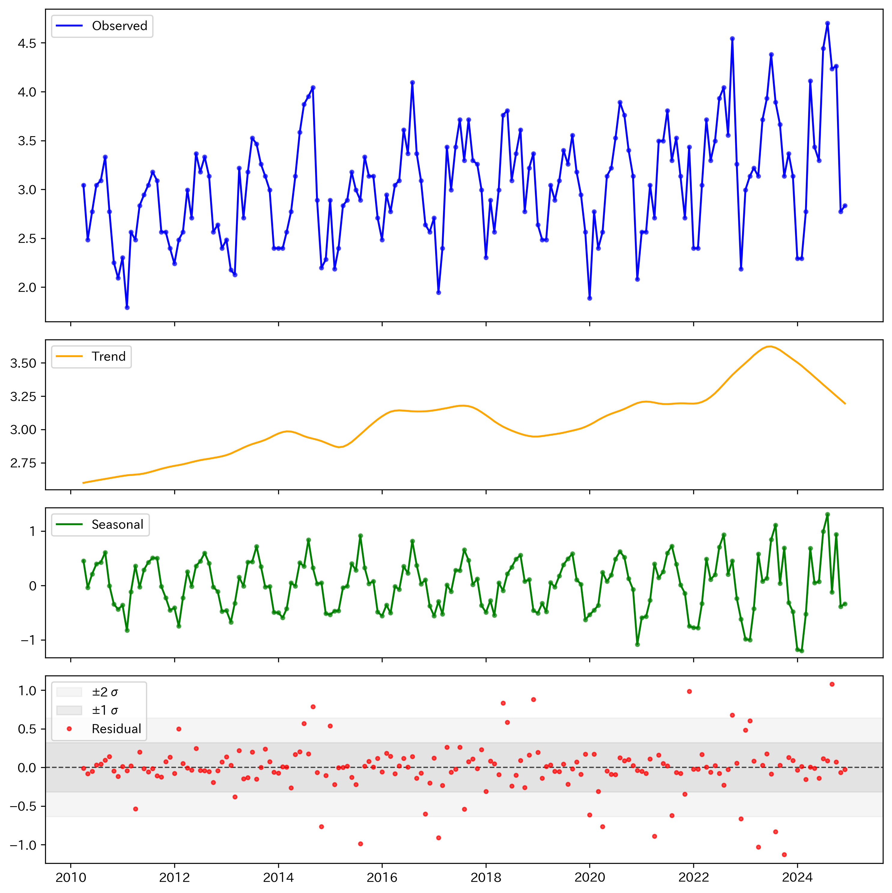
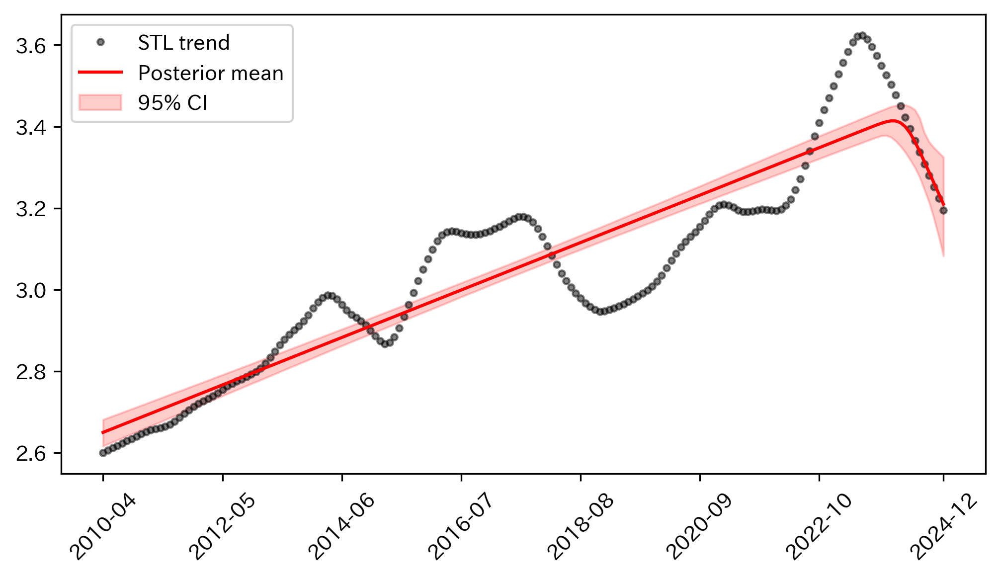

---

# POPsモニタリング — ブレークポイント回帰システム（バージョン 1.0k）

このリポジトリは、POPs（残留性有機汚染物質）モニタリングデータにおける**構造的ブレークポイントの検出**を行う、Streamlitベースの高度な分析システムを提供します。 
本システムは、**STL分解**、**古典的な区分回帰**、**ベイズMCMCブレークポイントモデル**、およびモデル証拠の推定のための**熱力学的積分（TI）**を統合しています。

本システムは、PCB、HCH、および関連物質などのPOPsに関する環境モニタリング、長期的な傾向評価、および規制評価を目的として設計されています。





---

## ✨ 主な機能

### **1. データ処理**
- 以下の情報を含むCSVファイルをアップロード：
  - `調査対象物質` (Substance)
  - `年月` (Year-Month)
  - `濃度` (Concentration)
- 時系列データの自動構築および対数変換。
- 開始日によるフィルタリング（オプション）。
- 物質ごとのセッション状態を保持する多物質対応。

---

## **2. STL分解**
- **LOESSを用いた季節・傾向分解（STL）**を実行します。
- 以下の成分を抽出します：
  - 傾向成分  
  - 季節成分  
  - 残差成分  
- 高品質なMatplotlibプロットで全成分を可視化。
- POPs規制年度の基準線をサポート。

---

## **3. 従来のブレークポイント分析**
使用手法：
- **区分線形回帰（pwlf）**
- **OLSに基づく区間フィッティング**
- **移動傾斜分析**

機能：
- ユーザーが選択可能な区間数（2～6）。
- ブレークポイントの自動検出。
- 各区間ごとの回帰統計表。
- エクスポート可能な高解像度のプロット。

---


## **4. ベイズ型ブレークポイントモデル (NumPyro)**
2つのベイズモデルを実装しています：

### **1ブレークモデル**
\[
y = \alpha + \beta_1 x + \beta_2 \max(0, x - \tau)
\]

### **2ブレークモデル**
\[
y = \alpha + \beta_1 x + (\beta_2 - \beta_1)\max(0, x - \tau_1) + (\beta_3 - \beta_2)\max(0, x - \tau_2)
\]

出力：
- すべてのパラメータに対する事後分布のサンプル。
- 事後予測平均曲線。
- ブレークポイントの95%信頼区間。
- τ、τ₁、τ₂のヒストグラム。
- 事後分布のサンプルフィット（50回のランダム抽出）。
- 1ブレークモデルと2ブレークモデルの平均フィットの比較プロット。

---

## **5. 熱力学的積分 (TI)**
- TI を用いて周辺尤度を計算します。
- ベイズモデル比較（1 ブレーク対 2 ブレーク）を可能にします。
- 専用のタブに統合されています。

---

## **6. バッチ処理**
- 複数の物質に対するHTMLレポートのバッチ生成。
- `report_generator.generate_html_report_full`を使用。

---

## 📁 入力CSV形式

システムが期待する形式：

| 列 | 意味 |
|--------|---------|
| `調査対象物質` | 物質名 |
| `年月` | 年-月 (YYYY-MM) |
| `濃度` | 濃度 (数値) |

例:

```csv
調査対象物質,年月,濃度
PCB-118,2010-01,0.12
PCB-118,2010-02,0.10
HCH-alpha,2010-01,0.05
```

---

## 🚀 実行方法

### 1. リポジトリをクローンする
```bash
git clone https://github.com/<your-username>/<your-repo>.git
cd <your-repo>
```

### 2. 依存関係をインストールする
```bash
pip install -r requirements.txt
```

主なライブラリ：
- streamlit  
- numpy / pandas  
- matplotlib / japanize-matplotlib  
- statsmodels  
- numpyro  
- pwlf  
- jax / jaxlib  

### 3. アプリを起動する
```bash
streamlit run st_base_break_point_v1k.py
```

### 4. ブラウザを開く
通常は：
```
http://localhost:8501
```

---

## 🧭 アプリの構造（タブ）

| タブ | 機能 |
|-----|----------|
| **1. データ** | 生データのプロット、STL/正規化/移動傾斜モード |
| **2. STL** | 季節・トレンド分解 |
| **3. 従来のブレークポイント** | pwlf + OLS回帰 |
| **4. ベイズ式ブレークポイント** | MCMC、事後分布プロット、信頼区間 |
| **5. TI** | 熱力学的積分 |
| **6. バッチ** | 複数物質のHTMLレポート生成 |

---

## 📊 出力例

- STL分解プロット  
- ブレークポイントを用いた古典的な区分回帰  
- ベイズ事後予測曲線  
- τ分布と信頼区間  
- 高解像度PNGエクスポート  

---

## 🧪 AIアシスタンス

このリポジトリは、**Microsoft Copilot**および**Google Gemini**の支援を受けて開発されました。  
最終的なコード、設計上の決定、および検証はすべて著者によって行われました。


---

## 📄 License (MIT)

```text
MIT License

Copyright (c) 2026 Hiroaki

Permission is hereby granted, free of charge, to any person obtaining a copy
of this software and associated documentation files (the "Software"), to deal
in the Software without restriction, including without limitation the rights
to use, copy, modify, merge, publish, distribute, sublicense, and/or sell
copies of the Software, and to permit persons to whom the Software is
furnished to do so, subject to the following conditions:

The above copyright notice and this permission notice shall be included in all
copies or substantial portions of the Software.

THE SOFTWARE IS PROVIDED "AS IS", WITHOUT WARRANTY OF ANY KIND, EXPRESS OR
IMPLIED, INCLUDING BUT NOT LIMITED TO THE WARRANTIES OF MERCHANTABILITY,
FITNESS FOR A PARTICULAR PURPOSE AND NONINFRINGEMENT. IN NO EVENT SHALL THE
AUTHORS OR COPYRIGHT HOLDERS BE LIABLE FOR ANY CLAIM, DAMAGES OR OTHER
LIABILITY, WHETHER IN AN ACTION OF CONTRACT, TORT OR OTHERWISE, ARISING FROM,
OUT OF OR IN CONNECTION WITH THE SOFTWARE OR THE USE OR OTHER DEALINGS IN THE
SOFTWARE.
```

---

## 🙌 Acknowledgements

- NumPyro team  
- pwlf (Piecewise Linear Fit)  
- Streamlit community  
- Environmental monitoring researchers  

---
