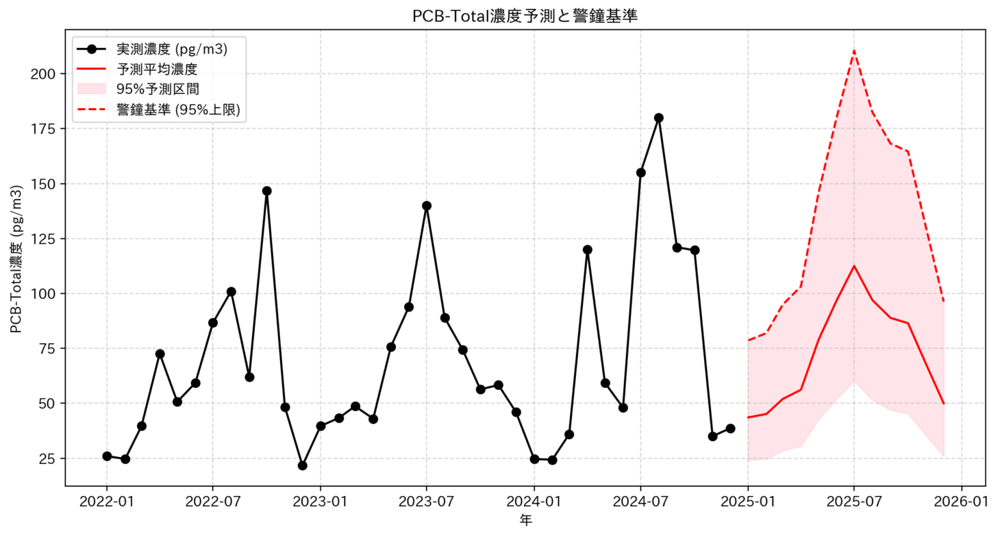

# Monthly Monitoring & Alert System
**SARIMAモデルを用いた月次データ監視と短期予測**

このディレクトリには、毎月測定される環境モニタリングデータを解析し、将来の予測および異常値の検知を行うためのツールが含まれています。

## 🎯 目的
- **季節性の把握**: 夏期や冬期に変動する濃度サイクルの可視化。
- **短期予測**: 向こう12ヶ月の濃度推移を予測。
- **警鐘（Alert）**: 予測される95%信頼区間から実測値が外れた場合、異常の兆候として検知。

## 🛠 使用モデル: SARIMA (Seasonal ARIMA)
長期的なトレンド（Trend）だけでなく、周期的な季節変動（Seasonality）を考慮した統計モデルを使用しています。
- **Log変換**: 指数関数的に変動する濃度データに対応するため、対数スケールで計算を行います。
- **自動前処理**: 3日間の測定値の平均化、および不検出値のクリーニングを自動で実施。



---

## 機能

- **インタラクティブなデータアップロード**
  - POPsモニタリングデータをCSVファイルとしてアップロードします。
  - ドロップダウンリストから対象物質を選択します。

- **前処理と変換**
  - 欠損値の処理を行います（`'---'` → `NaN`、前方補完）。
  - 日ごとの測定値（`1日目`、`2日目`、`3日目`）を平均化し、単一の月間濃度を算出します。
  - `年`と`月`から月ごとの時間インデックスを構築します。
  - 濃度に対して自然対数変換を適用します。

- **SARIMAによるモデリング**
  - 時系列モデリングに`statsmodels`の`SARIMAX`を使用します。
  - `pmdarima.auto_arima` によるオプションの **自動パラメータ探索**：
    - 季節周期は 12 に固定（月次データ）。
    - `(p, d, q)` および `(P, D, Q)` に対する妥当な範囲。
  - サイドバーのコントロールによる `(p, d, q, P, D, Q)` の手動上書き。
  - 推定モデルの**AIC**を表示します。

- **時系列診断**
  - 季節分解（トレンド、季節成分、残差）。
  - 定常性に関するADF検定と解釈。
  - 差分処理後のACF/PACFプロット。

- **予測およびアラートロジック**
  - ユーザーが選択した予測期間（1～36ヶ月）における将来の濃度を予測します。
  - 対数スケールで**95%予測区間**を算出し、元のスケールに逆変換します。
  - 以下の情報を可視化します：
    - 直近の観測濃度。
    - 予測平均値。
    - 95%予測帯。
    - 予測上限を**アラート閾値**とする。
  - アラートルール：
    - 将来の観測値が**95%予測上限**を超えた場合、**異常な増加（アラート）**としてフラグが立てられる。

---

## Input data format

The app expects a CSV file with at least the following columns (Japanese headers):

- **`調査対象物質`**: Target substance name (string).
- **`年`**: Year (integer).
- **`月`**: Month (integer).
- **`1日目`**, **`2日目`**, **`3日目`**: Daily concentration values (numeric, may contain `'---'` for missing).

Example (header row):

```text
調査対象物質,年,月,1日目,2日目,3日目
PCB-118,2010,1,0.12,0.10,0.11
PCB-118,2010,2,0.09,0.08,---
...
```

The app:

- Replaces `'---'` with missing values.
- Converts daily columns to numeric.
- Averages the available daily values into a single monthly concentration.

---

## Requirements

Main Python dependencies:

- `streamlit`
- `pandas`
- `numpy`
- `matplotlib`
- `japanize-matplotlib`
- `statsmodels`
- `pmdarima`

You can install them via:

```bash
pip install streamlit pandas numpy matplotlib japanize-matplotlib statsmodels pmdarima
```

---

## How to run

1. **Clone this repository**:

   ```bash
   git clone https://github.com/<your-username>/<your-repo-name>.git
   cd <your-repo-name>
   ```

2. **Install dependencies** (see above).

3. **Run the Streamlit app**:

   ```bash
   streamlit run st_pops_mon_v1a.py
   ```

4. Open the URL shown in the terminal (typically `http://localhost:8501`) in your browser.

5. In the **sidebar**:
   - Upload your PCB CSV file.
   - Select the target substance.
   - Choose the analysis start year.
   - Optionally click **“パラメータの自動設定”** to run `auto_arima`.
   - Adjust `(p, d, q, P, D, Q)` if needed.
   - Set the forecast horizon (months).

6. Explore the three tabs:
   - **📊 データ確認・前処理**: Data overview and log-transformed time series.
   - **📈 時系列分解・定常性確認**: Decomposition, ADF test, ACF/PACF.
   - **🚨 モデル予測・警鐘シミュレーション**: Forecasts, prediction intervals, and alert threshold.

---

## Alert interpretation

- **Alert threshold**: The **upper bound of the 95% prediction interval** for each future month.
- **Alert condition**:  
  When a future observed concentration exceeds this upper bound, it is interpreted as a **potential abnormal increase** and should trigger further investigation or risk assessment.

This system is intended as a **screening and monitoring tool**; final regulatory or scientific judgments should be made with expert review and additional context.

---

## License

This project is licensed under the **MIT License**.

```text
MIT License

Copyright (c) 2025 Hiroaki

Permission is hereby granted, free of charge, to any person obtaining a copy
of this software and associated documentation files (the "Software"), to deal
in the Software without restriction, including without limitation the rights
to use, copy, modify, merge, publish, distribute, sublicense, and/or sell
copies of the Software, and to permit persons to whom the Software is
furnished to do so, subject to the following conditions:

The above copyright notice and this permission notice shall be included in all
copies or substantial portions of the Software.

THE SOFTWARE IS PROVIDED "AS IS", WITHOUT WARRANTY OF ANY KIND, EXPRESS OR
IMPLIED, INCLUDING BUT NOT LIMITED TO THE WARRANTIES OF MERCHANTABILITY,
FITNESS FOR A PARTICULAR PURPOSE AND NONINFRINGEMENT. IN NO EVENT SHALL THE
AUTHORS OR COPYRIGHT HOLDERS BE LIABLE FOR ANY CLAIM, DAMAGES OR OTHER
LIABILITY, WHETHER IN AN ACTION OF CONTRACT, TORT OR OTHERWISE, ARISING FROM,
OUT OF OR IN CONNECTION WITH THE SOFTWARE OR THE USE OR OTHER DEALINGS IN THE
SOFTWARE.
```
