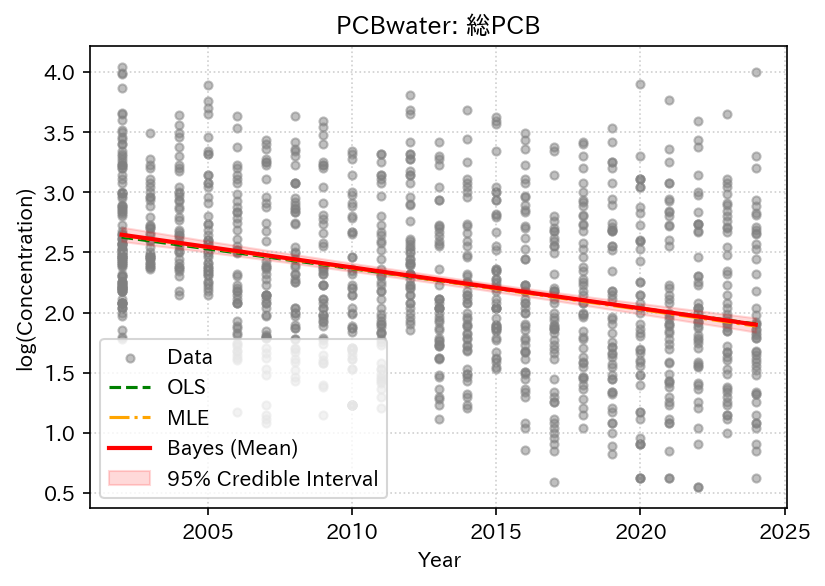

---

# 📊 ベイズ傾向分析 Web GUI アプリ

> **環境モニタリングデータ（検出・不検出）に向けた、OLS / MLE / FFT-KDE ベイズ回帰 & 熱力学積分（TI）統合解析ツール**

[](https://www.python.org/)
[](https://streamlit.io/)
[](https://opensource.org/licenses/MIT)

化学物質などの環境モニタリングデータ（濃度・不検出データ含む）に対し、最小二乗法 (OLS)、最大尤度推定 (MLE)、および FFT-KDE ベイズ推定を用いた傾向分析をブラウザ上で行える Streamlit アプリケーションです。



---

## 🌟 主な機能

* 🧹 **データ前処理・不検出対応**
  * データ内の記号表記（`tr()`, `nd`, `---` など）を自動検出して数値クレンジング。
  * 不検出（ND）データは検出限界値（DL）に基づき **$DL / \sqrt{2}$** で自動置換後、対数変換（$\log_{10}$）を実施。
* 📈 **複数の回帰・推論手法**
  * **OLS（普通最小二乗法）**: 直感的な基本トレンドの把握。
  * **MLE + AIC**: 環境省の標準手法等に基づく最大尤度推定とモデル比較。
  * **FFT-KDE ベイズ推定（MCMC）**: 高速フーリエ変換と核密度推定を活用した高速ベイズ推論と信頼・信用区間の算出。
  * **熱力学積分 (TI: Thermodynamic Integration)**: 周辺尤度（モデル証拠）の算出による客観的なモデル選択。
* 📝 **可視化と自動レポート生成**
  * 解析結果をひとまとめにした **HTML レポート** を自動生成。
  * 傾き（$a$）や切片（$b$）の後験分布（ヒストグラム、Corner plot、Joint posterior plot）を描画・保存可能。

---

## 🚀 起動方法

### 1. 依存ライブラリのインストール
事前に以下のパッケージをインストールしてください。

```bash
pip install streamlit numpy pandas matplotlib seaborn corner

```

### 2. アプリの起動

ターミナルで対象ディレクトリに移動し、以下のコマンドを実行します。

```bash
streamlit run ti_fft_kde_regression_v1f.py

```

### 3. ブラウザでアクセス

自動的にブラウザが開かない場合は、指定されたローカルURL（例: `http://localhost:8501`）へアクセスしてください。

---

## 📖 画面構成と使い方

### 📁 左側サイドバー (Sidebar)

* **Data Entry**: 解析対象の CSV ファイルをアップロード。
* **MCMC Settings**: MCMCのチェイン数（`n_walkers`）、ステップ数（`n_steps`）、バーンイン割合（`burn_frac`）、TIの $\beta$ スケールなどを細かく設定。

### 📊 メイン画面 (Main Dashboard)

* **Data Preview**: アップロードデータの確認、欠損値チェック。
* **Run Analysis**: ボタン一発で各種計算を実行（OLS, MLE, ベイズ, TI, HTMLレポート出力）。
* **Plot**: 計算された傾き $a$ や切片 $b$ の後験分布（パラメータの確信度）をグラフィカルに確認。

---

## 📁 入力データフォーマット

入力CSVには、以下の列が含まれている必要があります。

| 列名 (Column) | 意味 (Meaning) |
| --- | --- |
| `substance` | 物質名・化学物質識別名 |
| `year` | 観測年 |
| `concentration` | 測定濃度データ |
| `detection_limit` | 検出限界値 (DL) |

**入力例:**

```csv
substance,year,concentration,detection_limit
PCB-118,2010,0.12,0.05
PCB-118,2011,0.10,0.05
PCB-153,2010,0.03,0.02

```

---

## 📚 統計用語と出力の解説

### 1. 95%区間について（OLS/MLE vs ベイズ）

* **OLS / MLE (95% 信頼区間: Confidence Interval)**
* **意味**: 「同じ条件で調査を100回繰り返したとき、95回の確率で真のパラメータが含まれる範囲」。


* **ベイズ推定 (95% 信用区間: Credible Interval)**
* **意味**: 「**データが得られた下で、真のパラメータがこの範囲に存在する確率が 95% である**」という直感的な確率解釈。
* **評価**: 傾き $a$ の 95% 信用区間に `0` が含まれていない場合、統計的に意味のある増加・減少傾向（トレンド）が存在すると解釈できます。


### 2. 熱力学積分 (TI: Thermodynamic Integration) によるモデル選択

TIは「直線傾きモデル」と「一定（変化なし）モデル」のどちらがよりデータを適切に説明しているかを判定するベイズモデル比較手法です。

* **$\Delta \log Z > 0$（$\text{BF} > 1$）**: **直線モデル（Linear Model）** を支持（傾向変化あり）
* **$\Delta \log Z < 0$（$\text{BF} < 1$）**: **一定モデル（Constant Model）** を支持（有意な傾向なし）

> ⚠️ **注意**: OLS や MLE で有意（$p < 0.05$）と出ても、データのばらつきが大きい場合は TI により「一定モデル」が支持されることがあります。過剰適合（オーバーフィッティング）を防ぐための非常に慎重な指標です。

---

## ⚠️ 既知の注意事項 (Known Issue)

* **物質名の同一による上書き**
同じ CSV 内で媒体違い（例: 水質の `PCB` と 大気の `PCB`）のように全く同じ物質名を使用すると、内部データが上書きされる問題があります。
* **対策**: データ内の物質名を `PCB_Water` や `PCB_Air` のように一意な名前に変更して読み込んでください。


---

### Bayesian Trend Analysis GUI

**OLS / MLE / FFT-KDE Bayesian Regression + Thermodynamic Integration (TI)**

This tool provides an interactive Streamlit GUI for analyzing environmental monitoring data.

#### Key Features

1. **Data Cleaning**: Automatic non-detect substitution using $DL/\sqrt{2}$ and $\log_{10}$ transformation.
2. **Three Regression Methods**: OLS, MLE (MOE-based), and FFT-KDE Bayesian Regression.
3. **Model Evidence (TI)**: Marginal likelihood calculation using Thermodynamic Integration.
4. **Automated Reports**: Generates full HTML summary reports per substance.

#### Quick Start

```bash
pip install streamlit numpy pandas matplotlib seaborn corner
streamlit run ti_fft_kde_regression_v1f.py

```

---

## 🤖 AI アシスタンス表記

本リポジトリおよびコードの開発にあたっては、支援ツールとして **Google Gemini** および **Microsoft Copilot** を活用しています。最終的なコード検証・モデル調整・評価は著者が行っています。

---

## 📝 ライセンス

[MIT License](https://www.google.com/search?q=LICENSE)


